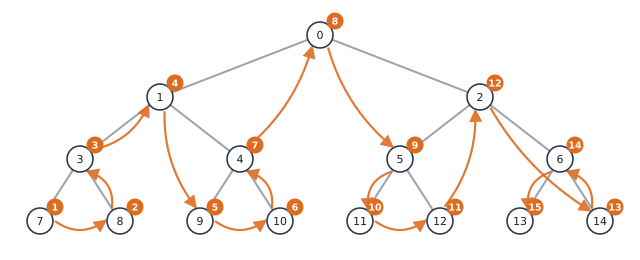
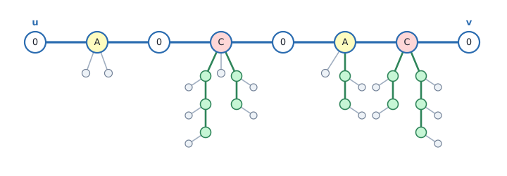
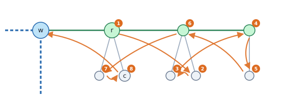
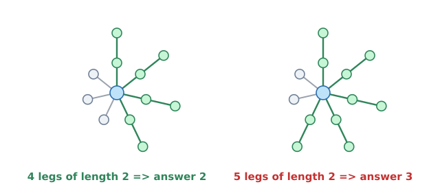

<style>
.hint{background:#fffbea;border:1px solid #f6e05e;border-right:5px solid #d69e2e;border-radius:6px;padding:6px 14px;margin:12px 0;page-break-inside:avoid}
.key{background:#ebf8ff;border:1px solid #90cdf4;border-right:5px solid #2b6cb0;border-radius:6px;padding:6px 14px;margin:12px 0;page-break-inside:avoid}
.warn{background:#fff5f5;border:1px solid #feb2b2;border-right:5px solid #c53030;border-radius:6px;padding:6px 14px;margin:12px 0;page-break-inside:avoid}
.proof{border-right:3px solid #cbd5e0;padding:2px 14px;margin:8px 0;color:#2d3748}
.fig{text-align:center;margin:10px 0 4px 0;page-break-inside:avoid}
.fig img{max-width:100%}
.cap{text-align:center;font-size:10pt;color:#4a5568;margin-bottom:14px}
.sub{text-align:center;color:#4a5568;margin-top:-6px}
.pb{page-break-before:always}
h2,h3{page-break-after:avoid}
pre{page-break-inside:auto !important}
.fig .cap p{margin:2px 0}
</style>

# ادیتوریال: پرش شپش

<p class="sub">دوره‌ی طلای المپیاد کامپیوتر — بر پایه‌ی Petrozavodsk 2025 (روز ۶، مسئله‌ی L)</p>

## صورت سوال به زبان گراف

درخت $T$ با $N$ رأس داده شده است. $T^d$ را گرافی روی همان رأس‌ها تعریف کنید که در آن دو رأس $x,y$ مجاورند اگر و فقط اگر $\mathrm{dist}_T(x,y)\le d$. سوال می‌پرسد:

<div class="key" style="text-align:center">

کمترین $d$ که $T^d$ مسیر همیلتونی داشته باشد.

</div>

<div class="fig">
<div class="cap">

شکل ۱ — نمونه‌ی ۴ (درخت دودویی کامل). عددهای نارنجی ترتیب بازدید با $d=2$ را نشان می‌دهند.

</div></div>

این ادیتوریال اول **هینت‌ها** را به ترتیب سختی می‌آورد. اگر می‌خواهید خودتان حل کنید، هر بار فقط یک هینت بخوانید و دوباره فکر کنید. حل کامل از صفحه‌ی بعدِ هینت‌ها شروع می‌شود.

## هینت‌ها

<div class="hint">

**هینت ۱ (آزمایش کنید).** برای $N$ کوچک، با DP روی زیرمجموعه‌ها (بیت‌ماسک) برای $d=1,2,3,\dots$ بررسی کنید که $T^d$ مسیر همیلتونی دارد یا نه. جواب‌ها را برای درخت‌های تصادفی چاپ کنید. چه عددهایی می‌بینید؟

</div>

<div class="hint">

**هینت ۲.** هیچ‌وقت جواب از $3$ بیشتر نمی‌شود. سعی کنید ثابت کنید: برای هر یال $uv$ از درخت، $T^3$ یک مسیر همیلتونی **از $u$ تا $v$** دارد. استقرا روی تعداد رأس‌ها؛ یال $uv$ را حذف کنید.

</div>

<div class="hint">

**هینت ۳.** جواب $1$ دقیقاً وقتی است که درخت یک مسیر باشد. پس همه‌ی سختی سوال این است: **$T^2$ کی مسیر همیلتونی دارد؟**

</div>

<div class="hint">

**هینت ۴.** ستاره همیشه جواب $2$ دارد. اما «عنکبوتی» که از مرکزش $5$ پای به طول $2$ بیرون آمده جواب $3$ دارد، در حالی که با $4$ پا جواب $2$ است (شکل ۲). چرا عدد $4$ مرز است؟

</div>

<div class="hint">

**هینت ۵.** فرض کنید مسیر همیلتونی $T^2$ از $u$ شروع و به $v$ ختم شود. مسیر ساده‌ی $u$ تا $v$ در درخت را **ستون** $P$ بنامید. بقیه‌ی درخت به شکل «شاخه»هایی از رأس‌های $P$ آویزان است. یک شاخه که فقط یک برگ است کار ساده‌ای دارد. شاخه‌ی **بزرگ** (حداقل ۲ رأس) چطور می‌تواند پیموده شود؟ از کدام رأس‌هایش می‌شود وارد یا خارج شد؟

</div>

<div class="hint">

**هینت ۶.** فرض کنید شاخه‌ی بزرگ $B$ با ریشه‌ی $r$ از رأس $w\in P$ آویزان است. تنها رأس‌های $B$ که در $T^2$ به بیرون از $B$ یال دارند، $r$ و فرزندان $r$ هستند، و هر فرزند $r$ فقط به $w$ وصل است. نتیجه بگیرید $B$ **یکجا** و از $r$ تا یکی از فرزندان $r$ پیموده می‌شود، و این کار یکی از دو یال مسیر در $w$ را مصرف می‌کند.

</div>

<div class="hint">

**هینت ۷.** کدام درخت‌ها مسیر همیلتونی در مربعشان از ریشه تا یکی از فرزندان ریشه دارند؟ پاسخ: درخت‌هایی که در آن‌ها **هر رأس حداکثر یک فرزند غیربرگ دارد** (یک «کرم» که از ریشه شروع می‌شود).

</div>

<div class="hint">

**هینت ۸.** هر $w$ روی ستون حداکثر دو یال در مسیر دارد، پس حداکثر **دو** شاخه‌ی بزرگ می‌تواند داشته باشد. رأس‌های ستون را دسته‌بندی کنید: بدون همسایه‌ی بیرونی ($0$)، حداکثر یک شاخه‌ی بزرگ ($A$)، دقیقاً دو شاخه‌ی بزرگ ($C$). کدام دنباله‌ها روی ستون مجازند؟

</div>

<div class="hint">

**هینت ۹.** برای هر رأس ستون فقط مهم است که مسیر از **خودِ** $w$ وارد یا خارج می‌شود یا از یکی از همسایه‌های بیرونی‌اش. این دو حالت را $W$ و $R$ بنامید. از دو $R$ پشت‌سرهم نمی‌شود رد شد. یک ماشین حالت با دو حالت بسازید.

</div>

<div class="hint">

**هینت ۱۰.** شرط نهایی: اگر $A$ها را نادیده بگیرید، دنباله‌ی نوع‌ها روی ستون باید به شکل $0^+(C\,0^+)^*$ باشد. حالا باید روی **همه‌ی ستون‌های ممکن** جست‌وجو کنید. این کار با یک DP روی درخت ریشه‌دار (مثل پیدا کردن قطر) در $O(N)$ انجام می‌شود.

</div>

<div class="pb"></div>

## حل کامل

### گام ۱: جواب حداکثر ۳ است

<div class="key">

**لم ۱.** برای هر درخت $T$ و هر یال $uv$ از آن، $T^3$ مسیر همیلتونی از $u$ تا $v$ دارد.

</div>

<div class="proof">

استقرا روی تعداد رأس‌ها. با حذف یال $uv$، درخت به دو تکه‌ی $T_u\ni u$ و $T_v\ni v$ تقسیم می‌شود.

- اگر $|T_u|\ge2$، یک همسایه‌ی $u'$ از $u$ در $T_u$ بردارید. طبق فرض استقرا، $T_u^3$ مسیری از $u$ تا $u'$ دارد که همه‌ی $T_u$ را می‌پوشاند. اگر $|T_u|=1$، این مسیر فقط $u$ است و $u'=u$.
- به همین شکل، مسیری از $v'$ تا $v$ داریم که همه‌ی $T_v$ را می‌پوشاند.

حالا این دو را به هم می‌چسبانیم: $u\to\cdots\to u'\;\to\;v'\to\cdots\to v$. یال وسط مجاز است، چون $\mathrm{dist}(u',v')\le \mathrm{dist}(u',u)+1+\mathrm{dist}(v,v')\le3$. $\blacksquare$

</div>

این حالت خاصی از قضیه‌ی معروف **Sekanina** است: مکعب هر گراف همبند Hamiltonian-connected است. جواب $1$ هم دقیقاً وقتی است که درخت مسیر باشد، چون $T^1=T$. پس فقط باید تشخیص دهیم:

<div class="key" style="text-align:center">

آیا $T^2$ مسیر همیلتونی دارد؟ اگر بله جواب $2$ است، وگرنه $3$.

</div>

### گام ۲: ستون و شاخه‌ها

فرض کنید مسیر همیلتونی $T^2$ از $u$ به $v$ می‌رود و $P$ مسیر $u$ تا $v$ در درخت است. برای $w\in P$، هر مؤلفه‌ی $T-P$ که به $w$ وصل است یک **شاخه** است. شاخه یا یک برگ تنهاست، یا **بزرگ** است (حداقل ۲ رأس؛ یعنی ریشه‌اش در درخت برگ نیست).

<div class="fig">
<div class="cap">

شکل ۲ — ستون (آبی) با رأس‌هایی از نوع 0، A و C. شاخه‌های بزرگ سبزند و هر کدام یک «کرم از ریشه» است.

</div></div>

<div class="key">

**لم ۲ (شاخه‌ی بزرگ یکجا پیموده می‌شود).** اگر $B$ شاخه‌ی بزرگی با ریشه‌ی $r$ آویزان از $w$ باشد، مسیر همیلتونی $B$ را در یک تکه‌ی پیوسته می‌پیماید، از $r$ تا یکی از فرزندان $r$ مثل $c$، و بلافاصله بعد از $c$ به $w$ می‌رود (یا از $w$ به $c$ می‌آید).

</div>

<div class="proof">

یال‌های $T^2$ بین $B$ و بیرون فقط از $r$ (به $w$ و همسایه‌های دیگر $w$) و از فرزندان $r$ (فقط به $w$) خارج می‌شوند. دو سرِ مسیر همیلتونی، $u$ و $v$، بیرون از $B$ هستند. پس هر تکه‌ی مسیر داخل $B$ دو «درِ خروج» دارد.

اگر هر دو درِ یک تکه فرزندان $r$ باشند، هر دو به $w$ وصل می‌شوند و دور تشکیل می‌شود، که ممکن نیست. پس هر تکه شامل $r$ است، یعنی فقط **یک** تکه وجود دارد. سرِ دیگر آن تکه باید فرزندی از $r$ باشد که به $w$ وصل می‌شود. $\blacksquare$

</div>

<div class="key">

**لم ۳ (کرم از ریشه).** درخت $B$ با ریشه‌ی $r$ در $B^2$ مسیر همیلتونی از $r$ تا یکی از فرزندان $r$ دارد، اگر و فقط اگر هر رأس $B$ **حداکثر یک فرزند غیربرگ** داشته باشد. به‌عبارت دیگر، رأس‌های غیربرگ یک زنجیر $r=c_1,c_2,\dots,c_m$ می‌سازند و بقیه برگ‌اند.

</div>

<div class="proof">

**(⇐) ساختن مسیر.** مسیر $H(c_i)$ را بازگشتی می‌سازیم. این مسیر از $c_i$ شروع می‌شود، کل زیردرخت $c_i$ را می‌پوشاند و به یکی از فرزندان $c_i$ ختم می‌شود:

$$H(c_i)=c_i,\ \mathrm{reverse}\big(H(c_{i+1})\big),\ \ell_1,\ell_2,\dots,\ell_k$$

اینجا $\ell_j$ها برگ‌های $c_i$ هستند. برای $c_m$ قسمت وسط خالی است. هر پرش حداکثر به فاصله‌ی $2$ است:

- از $c_i$ به آخرِ $H(c_{i+1})$، که نوه‌ی $c_i$ است: فاصله‌ی $2$.
- از $c_{i+1}$ به $\ell_1$، و بین دو برگ $c_i$: فاصله‌ی $2$.

مسیر هم به یک فرزند $c_i$ ختم می‌شود: به $\ell_k$، یا اگر $c_i$ برگی نداشت به $c_{i+1}$ (شکل ۳).

**(⇒)** مسیر مورد نظر یک مسیر همیلتونی در $B^2$ با دو سرِ $r$ و $c$ است. همین تحلیل را روی $B$ با ستون $(r,c)$ اجرا کنید. $B$ کوچک‌تر از $T$ است، پس استقرا روی اندازه کار می‌کند. نتیجه این است که یکی از $r$ و $c$ همسایه‌ی بیرونی ندارد و بقیه‌ی شاخه‌ها باز هم کرم از ریشه‌اند. همین یعنی «هر رأس حداکثر یک فرزند غیربرگ».

</div>

<div class="fig">
<div class="cap">

شکل ۳ — پیمودن یک شاخه‌ی بزرگ با ساختِ لم ۳: از r شروع می‌کند، به فرزند c ختم می‌شود و بعد به w برمی‌گردد.

</div></div>

### گام ۳: نوع رأس‌های ستون

برای $w\in P$ دو عدد تعریف کنید: $k$ تعداد شاخه‌های بزرگ آویزان از $w$، و $s$ تعداد همه‌ی همسایه‌های $w$ بیرون از $P$. طبق لم ۲ هر شاخه‌ی بزرگ یکی از (حداکثر دو) یال مسیر در $w$ را مصرف می‌کند، پس $k\le2$:

| نوع | شرط | توضیح |
|:---:|:---|:---|
| $0$ | $s=0$ | فقط خودِ $w$ |
| $A$ | $k\le1,\ s\ge1$ | برگ‌ها و حداکثر یک شاخه‌ی بزرگ |
| $C$ | $k=2$ | دو شاخه‌ی بزرگ؛ هر دو یال مسیرِ $w$ مصرف شده‌اند |
| — | $k\ge3$ | ستون غیرممکن |

برگ‌های $w$ و ریشه‌های شاخه‌ها همگی همسایه‌ی $w$ هستند، پس دوبه‌دو در $T^2$ مجاورند. یعنی هر ترتیبی بین آن‌ها مجاز است.

### گام ۴: ماشین حالت

«خوشه»ی $w$ یعنی خود $w$ همراه با شاخه‌هایش. مسیر وارد خوشه می‌شود و از آن خارج می‌شود، یا از **خودِ $w$** (حالت $W$) یا از یک **ریشه/برگ** خوشه (حالت $R$). عبور از خوشه‌ی $w_i$ به $w_{i+1}$ با هر ترکیبی جز $R\to R$ ممکن است، چون یک ریشه‌ی خوشه‌ی $w_i$ از یک ریشه‌ی خوشه‌ی $w_{i+1}$ فاصله‌ی $3$ دارد.

با بررسی حالت‌های ورود و خروج هر نوع، و با در نظر گرفتن اینکه $u$ مثل ورودی با حالت $R$ رفتار می‌کند و پایان باید $W$ باشد، به این جدول می‌رسیم:

| نوع رأس | از حالت $W$ | از حالت $R$ |
|:---:|:---:|:---:|
| $0$ | $W$ | $W$ |
| $A$ | $W$ (یا $R$) | $R$ |
| $C$ | $R$ | غیرممکن |

حالت $W$ همیشه بهتر از $R$ است، پس می‌شود حریصانه عمل کرد. $A$ حالت را عوض نمی‌کند. شروع از $R$ است و پایان باید $W$ باشد. نتیجه:

<div class="key">

**قضیه.** $T^2$ مسیر همیلتونی دارد، اگر و فقط اگر مسیری مثل $P$ در درخت وجود داشته باشد که:

1. هر شاخه‌ی بزرگ آویزان از $P$ «کرم از ریشه» باشد (لم ۳)؛
2. هیچ رأس $P$ سه شاخه‌ی بزرگ یا بیشتر نداشته باشد؛
3. اگر رأس‌های نوع $A$ را حذف کنیم، دنباله‌ی نوع‌ها روی $P$ به شکل $\;0^+\,(C\,0^+)^*\;$ باشد. یعنی با $0$ شروع و تمام شود، و بین هر دو $C$ حداقل یک $0$ باشد.

</div>

<div class="warn">

**درباره‌ی اثبات.** لم‌های ۱ تا ۳ و جدول حالت‌ها در بالا اثبات شده‌اند. یک ادعا فقط در حد طرح اثبات است: اینکه همیشه مسیر همیلتونی‌ای هست که خوشه‌ها را **به ترتیب** و هر کدام را یکجا می‌پیماید. بدون آن، مسیر می‌تواند از روی یک رأس ستون بپرد و بعداً برگردد. به همین دلیل الگوریتم با brute force (بیت‌ماسک روی $T^d$) مقایسه شد: روی **همه‌ی** درخت‌های برچسب‌دار تا $8$ رأس و حدود ۴۰ هزار درخت تصادفی و هدفمند تا $17$ رأس، و جواب‌ها همه یکسان بودند. این مفهوم در مقاله‌ی Radoszewski و Rytter (2011) با نام **horsetail** آمده است.

</div>

### گام ۵: الگوریتم خطی

**الف) کرم بودن شاخه‌ها.** برای هر یال جهت‌دار $w\to x$ مشخص کنید آیا مؤلفه‌ی $x$ (بعد از حذف یال) کرم از $x$ است. رأس $x$ همسایه‌های غیربرگ دارد، به‌جز $w$. اگر تعدادشان $0$ باشد، کرم است. اگر $\ge2$ باشد، کرم نیست. اگر دقیقاً $1$ باشد، مثلاً $y$، جواب برابر جواب $x\to y$ است. این یک زنجیر است که با memo در مجموع $O(N)$ طول می‌کشد. اگر دنبال زنجیر بازگشتی بروید، عمق تا $10^6$ می‌رسد، پس پیاده‌سازی غیربازگشتی بهتر است.

**ب) نوع رأس به شرط دو همسایه‌ی ستونی.** برای هر رأس این‌ها را از قبل نگه دارید: تعداد همسایه‌های غیربرگ ($K$)، و تعداد همسایه‌های غیربرگی که شاخه‌شان کرم نیست ($B$). وقتی دو همسایه‌ی ستونی معلوم باشند، با کم کردن سهم آن دو، نوع رأس در $O(1)$ به دست می‌آید. شرط‌ها: $B=0$ و $K\le2$.

**ج) DP روی درخت ریشه‌دار.** حالت‌ها را در یک ماسک ۳بیتی نگه دارید: «هنوز نمادی نیامده»، «آخرین نماد $0$ بود»، «آخرین نماد $C$ بود». مقدار $\mathrm{dn}[c]$ یعنی ماسک حالت‌های ممکن برای ستون‌هایی که از یک سرِ داخل زیردرخت $c$ شروع می‌شوند، تا $c$ بالا می‌آیند و به پدر $c$ ادامه می‌دهند. در بالاترین رأسِ ستون، یعنی رأسی که هر دو همسایه‌ی ستونی‌اش فرزند هستند، دو زنجیر را به هم وصل کنید. یک زنجیر را برعکس می‌خوانیم و شرط الحاق را با جدول گام ۴ چک می‌کنیم.

<div class="warn">

**دام زمانی.** امتحان کردن همه‌ی جفت فرزندها در رأس بالا $O(\deg^2)$ است. در یک ستاره با $10^6$ برگ این زمان منفجر می‌شود. نوع رأس فقط به دو چیز از هر فرزند بستگی دارد: «غیربرگ بودن» و «کرم بودن شاخه‌اش»، به‌علاوه‌ی ماسک $\mathrm{dn}$ آن فرزند. پس فرزندها را در حداکثر $15$ کلاس دسته کنید و فقط جفت کلاس‌ها را امتحان کنید، با حداکثر ۲ نماینده از هر کلاس.

</div>

**روش دیگر (rerooting).** برای هر یال جهت‌دار $v\to y$، ماسک ستون‌هایی را حساب کنید که در سمت $v$ شروع می‌شوند و به $y$ می‌رسند. این کار با دو گذر انجام می‌شود، یکی پایین‌به‌بالا و یکی بالا‌به‌پایین. جواب $2$ است اگر برای یک یال، $y$ بتواند آخرین رأس ستون باشد. در این روش جفت کردن لازم نیست، چون هر ستون یک سرِ پایانی دارد. ولی در گذر بالا‌به‌پایین باید سهم هر همسایه را با شمارنده‌ها از مجموع کم کنید.

**پیچیدگی:** زمان و حافظه $O(N)$. روی بدترین تست حدود $0.6$ ثانیه طول می‌کشد، با محدودیت ۲ ثانیه.

## حل زیرمسئله‌ها

**زیرمسئله‌ی ۱ ($N\le15$) — ۱۰ امتیاز.** برای $d=1,2,3$ با DP روی زیرمجموعه‌ها: $f[\text{mask}][\text{last}]$. زمان $O(2^N N^2)$. اینجا حتی لازم نیست بدانید جواب حداکثر ۳ است.

**زیرمسئله‌ی ۲ (عنکبوت) — ۱۲ امتیاز.** اگر رأس درجه‌ی ≥۳ نیست، درخت مسیر است و جواب $1$. وگرنه، اگر $L$ تعداد پاهای با طول حداقل ۲ باشد:

<div class="key" style="text-align:center">

اگر $L\le4$ جواب $2$ است، و اگر $L\ge5$ جواب $3$.

</div>

<div class="fig">
<div class="cap">

شکل ۴ — عنکبوت با ۴ پای بلند (جواب ۲) و با ۵ پای بلند (جواب ۳).

</div></div>

<div class="proof">

ستون را از انتهای یک پای بلند، از مرکز، تا انتهای پای بلند دیگر بکشید. پاهای بلند باقی‌مانده شاخه‌های بزرگ مرکزند، و هر کدام یک مسیر است که کرم از ریشه است. پس با $L\le4$ مرکز حداکثر دو شاخه‌ی بزرگ دارد و نوعش $C$ یا $A$ است. رأس‌های پاها روی ستون نوع $0$ دارند، و دنباله به شکل $0\cdots0\,C\,0\cdots0$ مجاز است.

با $L\ge5$ هر ستونی که از مرکز بگذرد، حداقل ۳ پای بلند بیرون از ستون می‌گذارد، که ممکن نیست. ستونی که از مرکز نگذرد، شاخه‌ای دارد که مرکز را با ≥۴ فرزند غیربرگ در خود دارد، که کرم نیست.

</div>

**زیرمسئله‌ی ۳ ($N\le300$) — ۱۸ امتیاز.** با دانستن قضیه، برای هر جفت $(u,v)$ ستون را مستقیم بسازید و شرط‌ها را در $O(N)$ چک کنید. کرم بودن شاخه‌ها را برای هر ریشه‌ی $u$ با یک DFS حساب کنید. زمان کل $O(N^3)$.

**زیرمسئله‌ی ۴ ($N\le2000$) — ۲۵ امتیاز.** سرِ اول $u$ را ثابت کنید و درخت را از $u$ ریشه کنید. با یک DFS حالت ماشین را برای همه‌ی ستون‌هایی که از $u$ شروع می‌شوند هم‌زمان جلو ببرید. برای هر $u$ زمان $O(N)$ است، پس در کل $O(N^2)$.

**زیرمسئله‌ی ۵ — ۳۵ امتیاز.** الگوریتم خطی گام ۵.

## اشتباه‌های رایج

<div class="warn">

- **«جواب ۲ اگر و فقط اگر درخت کرم باشد».** این شرط وجود **دور** همیلتونی در $T^2$ است (Harary و Schwenk)، نه مسیر. مثال نقض: درخت دودویی ۷رأسی (نمونه‌ی ۳) کرم نیست ولی جوابش ۲ است.
- **فرض اینکه جواب همیشه ≤۲ است.** عنکبوت با ۵ پای به طول ۲ مثال نقض است.
- **فراموش کردن شرط کرم بودن شاخه‌ها،** یا اجازه دادن به دو $C$ بدون $0$ بینشان.
- **جفت کردن $O(\deg^2)$** در رأس‌هایی با درجه‌ی خیلی زیاد.
- **DFS بازگشتی با عمق $10^6$.** ممکن است روی سرور stack overflow بدهد؛ پیاده‌سازی غیربازگشتی امن‌تر است.
- **پاک نکردن متغیرهای سراسری.** تابع چند بار صدا زده می‌شود و $\sum N$ تا $10^6$ است.

</div>

## منابع

- M. Sekanina, *On an ordering of the set of vertices of a connected graph*, 1960. (مکعب گراف همبند)
- F. Harary, A. Schwenk, *Trees with Hamiltonian square*, 1971. (دور همیلتونی ⇔ کرم)
- J. Radoszewski, W. Rytter, *Hamiltonian paths in the square of a tree*, ISAAC 2011. (horsetail)
- POI 2013، سوال *Multidrink*. (همین سوال با دو سرِ ثابت)

<div class="pb"></div>

## پیوست: کد راه‌حل اصلی

```cpp
#include "lice.h"
#include <bits/stdc++.h>
using namespace std;
// answer<=3 (T^3 Hamiltonian-connected); 1 iff path; 2 iff T^2 has a Hamiltonian path:
// exists spine P, each non-leaf branch off P is a caterpillar from its root,
// vertex types on P: 0 (no off-neighbours), A (<=1 big branch), C (2 big branches),
// and the 0/C word (A ignored) matches 0+(C0+)*.
int min_days(int n, vector<int> U, vector<int> V){
    vector<int> deg(n,0);
    for(int i=0;i<n-1;i++) deg[U[i]]++,deg[V[i]]++;
    if(*max_element(deg.begin(),deg.end())<=2) return 1;
    int m=2*(n-1);
    vector<int> st(n+1,0),adj(m),rv(m),pos(n);
    for(int i=0;i<n;i++) st[i+1]=st[i]+deg[i];
    for(int i=0;i<n;i++) pos[i]=st[i];
    for(int i=0;i<n-1;i++){int a=pos[U[i]]++,b=pos[V[i]]++;adj[a]=V[i];adj[b]=U[i];rv[a]=b;rv[b]=a;}
    auto nl=[&](int x){return deg[x]>=2;};
    vector<int> NL(n,0),BAD(n,0);
    for(int x=0;x<n;x++) for(int e=st[x];e<st[x+1];e++) NL[x]+=nl(adj[e]);
    // good[e], e=(w->x): branch at x (away from w) is a caterpillar from x
    vector<signed char> good(m,-1); vector<int> stk;
    for(int e0=0;e0<m;e0++){
        if(good[e0]>=0) continue;
        int e=e0,res; stk.clear();
        while(1){
            if(good[e]>=0){res=good[e];break;}
            int x=adj[e],w=adj[rv[e]],c=NL[x]-nl(w);
            if(!nl(x)||c==0){res=1;break;}
            if(c>=2){res=0;break;}
            stk.push_back(e);
            for(int g=st[x];g<st[x+1];g++) if(adj[g]!=w&&nl(adj[g])){e=g;break;}
        }
        good[e]=res; for(int f:stk) good[f]=res;
    }
    for(int x=0;x<n;x++) for(int e=st[x];e<st[x+1];e++) if(nl(adj[e])&&!good[e]) BAD[x]++;
    // type of w with spine-neighbours given by edges e1(,e2): -1 bad, 0, 1=A, 2=C
    auto typ=[&](int w,int sz,int e1,int e2){
        int K=NL[w],B=BAD[w];
        if(nl(adj[e1])){K--;B-=!good[e1];}
        if(sz==2&&nl(adj[e2])){K--;B-=!good[e2];}
        if(B>0||K>2) return -1;
        if(deg[w]==sz) return 0;
        return K==2?2:1;
    };
    // masks: 1 = no symbol yet, 2 = last symbol 0, 4 = last symbol C
    auto step=[&](int s,int t){
        if(t<0||!s) return 0;
        if(t==1) return s;
        if(t==0) return 2;
        return (s&2)?4:0;
    };
    vector<int> par(n,-1),pe(n,-1),ord; ord.reserve(n); ord.push_back(0); par[0]=0;
    for(int i=0;i<(int)ord.size();i++){int x=ord[i];for(int e=st[x];e<st[x+1];e++){int y=adj[e];if(par[y]<0){par[y]=x;pe[y]=rv[e];ord.push_back(y);}}}
    par[0]=-1;
    vector<int> dn(n,0);
    for(int i=n-1;i>0;i--){
        int c=ord[i],s=step(1,typ(c,1,pe[c],0));
        for(int e=st[c];e<st[c+1];e++) if(adj[e]!=par[c]) s|=step(dn[adj[e]],typ(c,2,e,pe[c]));
        dn[c]=s;
    }
    auto fin=[&](int s,int p){ return p==2?s!=0:(s&2)!=0; };
    for(int v=0;v<n;v++){
        int fe[15],se[15],cnt[15]={0};
        for(int e=st[v];e<st[v+1];e++){
            int d=adj[e]; if(d==par[v]||!dn[d]) continue;
            if(step(dn[d],typ(v,1,e,0))&2) return 2;
            int k=nl(d)?1+(good[e]?7:0)+dn[d]-1:0;
            if(cnt[k]==0) fe[k]=e; else if(cnt[k]==1) se[k]=e;
            if(cnt[k]<2) cnt[k]++;
        }
        for(int a=0;a<15;a++) if(cnt[a]) for(int b=a;b<15;b++){
            if(!cnt[b]||(a==b&&cnt[a]<2)) continue;
            int e1=fe[a],e2=a==b?se[a]:fe[b],t=typ(v,2,e1,e2);
            if(t<0) continue;
            int m1=dn[adj[e1]],m2=dn[adj[e2]];
            for(int x=1;x<=4;x<<=1) if(m1&x) for(int y=1;y<=4;y<<=1) if(m2&y) if(fin(step(x,t),y)) return 2;
        }
    }
    return 3;
}
```
